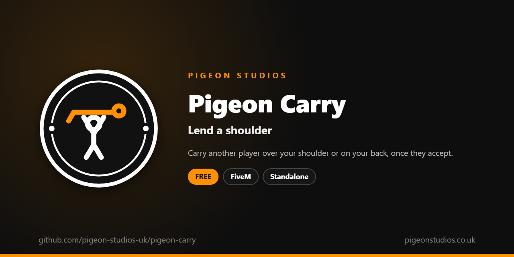

<div align="center">
  

  <h1>Pigeon Carry</h1>

  <p><strong>Carry another player over your shoulder or on your back, once they accept, checked by the server.</strong></p>

  <p>
    <a href="https://github.com/pigeon-studios-uk/pigeon-carry/releases/latest"></a>
    <a href="LICENSE.md"></a>
    <a href="https://discord.gg/2NFVWEUmDF"></a>
    
  </p>

  <p>
    <a href="https://github.com/pigeon-studios-uk/pigeon-carry/releases/latest"><strong>Download</strong></a> ·
    <a href="#installation">Install</a> ·
    <a href="#configuration">Configure</a> ·
    <a href="CHANGELOG.md">Changelog</a> ·
    <a href="https://discord.gg/2NFVWEUmDF">Support</a>
  </p>
</div>

---

## Contents

- [Overview](#overview)
- [Features](#features)
- [Requirements](#requirements)
- [Installation](#installation)
- [Updating](#updating)
- [Configuration](#configuration)
- [Localisation](#localisation)
- [Commands and exports](#commands-and-exports)
- [How it works](#how-it-works)
- [Update checker](#update-checker)
- [Performance](#performance)
- [Security](#security)
- [Troubleshooting](#troubleshooting)
- [FAQ](#faq)
- [Support](#support)
- [Contributing](#contributing)
- [Licence](#licence)
- [Credits](#credits)

## Overview

Pigeon Carry is a free resource by [Pigeon Studios](https://pigeonstudios.co.uk) that lets players carry each other. Pulling an injured friend out of a gunfight, a medic getting a patient to the ambulance, a piggyback down the pier: roleplay keeps needing it, and GTA has no way to do it.

Stand next to someone and use `/carry` to put them over your shoulder, or `/piggyback` to give them a ride on your back. They get a request to accept or decline first, so nobody gets picked up who doesn't want to be. Use the command again to put them down, and they can get down themselves too.

## Features

- **Two ways.** `/carry` over the shoulder, `/piggyback` on the back, with GTA's own paired animations.
- **Only if they say yes.** The other player accepts or declines with a key, Y or N by default.
- **Either can end it.** The carrier puts them down, or the carried player gets down.
- **Checked by the server.** Distance, on foot, nobody already busy, and one request a second.
- **Character names.** In requests, on Qbox, QBCore and ESX.
- **Ends safely.** If the carrier dies, gets in a vehicle or leaves, the carried player is put down.
- **23 languages.** Follows ox_lib's language, or set your own.
- **Standalone.** No framework or other resources needed.

## Requirements

| Requirement | Version | Notes |
|---|---|---|
| FXServer | A [recommended artifact](https://runtime.fivem.net/artifacts/) | |
| OneSync | On | The default on current servers |
| [ox_lib](https://github.com/communityox/ox_lib) | Optional | Used for messages and the language if it's running |

**Frameworks:** none needed. It works the same on standalone and vMenu servers, ESX Legacy, QBCore, Qbox and ox_core.

## Installation

1. **Download** `pigeon-carry.zip` from the [latest release](https://github.com/pigeon-studios-uk/pigeon-carry/releases/latest). Don't use the green **Code** button; release zips are the tested builds.
2. **Extract** it into your server's `resources` folder. The folder must be called `pigeon-carry`.
3. **Start it** by adding this to `server.cfg`, after ox_lib if you use it:

   ```cfg
   ensure pigeon-carry
   ```

4. **Configure** it in `configuration/config.lua` if you want to change anything. The defaults work as they are.
5. **Restart** your server. The console shows one line from the update checker:

   ```text
   [Pigeon Studios] Pigeon Carry v1.0.0 is up to date.
   ```

## Updating

1. Read the [changelog](CHANGELOG.md) for every version between yours and the latest, especially any **Upgrade notes**.
2. Back up your `configuration/` and `locales/` folders.
3. Replace the `pigeon-carry` folder with the new release.
4. Copy your changed settings into the new `configuration/config.lua`. Don't copy the old file over the new one; new versions can add settings.
5. Restart the resource.

## Configuration

All settings are in `configuration/config.lua`, each explained by a comment next to it.

| Setting | Default | What it does |
|---|---|---|
| `Config.Locale` | `'auto'` | The language. `'auto'` follows ox_lib's; or a code such as `'de'` (see [Localisation](#localisation)) |
| `Config.Commands` | `carry, piggyback` | The command names |
| `Config.AcceptKey` | `'Y'` | The default key to accept a request |
| `Config.DeclineKey` | `'N'` | The default key to decline a request |
| `Config.Distance` | `2.0` | Metres away the other player can be |
| `Config.RequestSeconds` | `10` | Seconds a request waits for an answer |
| `Config.Names` | `'character'` | `'character'` for character names on Qbox, QBCore and ESX, or `'player'` for FiveM names |
| `Config.Notifications` | `'auto'` | `'auto'` (ox_lib if it's running), `'ox_lib'` or `'gta'` |

## Localisation

Pigeon Carry comes in 23 languages: `en` English, `cs` Czech, `da` Danish, `de` German, `es` Spanish, `et` Estonian, `fi` Finnish, `fr` French, `hr` Croatian, `hu` Hungarian, `id` Indonesian, `it` Italian, `nl` Dutch, `no` Norwegian, `pl` Polish, `pt` Portuguese, `pt-br` Brazilian Portuguese, `ro` Romanian, `sl` Slovenian, `sv` Swedish, `tr` Turkish, `zh-cn` Simplified Chinese and `zh-tw` Traditional Chinese. They're the languages ox_lib ships, so your server may already have one set.

With `Config.Locale = 'auto'` (the default), it uses ox_lib's language, so one line in `server.cfg` sets it for this and every other resource that follows ox_lib:

```cfg
setr ox:locale "de"
```

Use `setr`, not `set`, so players' games get it too. Without it, or for a language that isn't in `locales/`, the text is English. To choose a language for this resource only, set `Config.Locale` to its code, such as `'fr'` or `'pt-br'`.

The request shows the default keys from the config. If players change them in GTA's key bindings, the message still shows the defaults. Chinese text can show as blank in GTA's own text, such as its notifications, because GTA only loads its Chinese font when the game itself is set to Chinese. ox_lib's notifications show every language.

Every file was checked for missing text and placeholders, but not every translation has been read by a native speaker yet. If something reads wrong, please send a fix; see [Contributing](#contributing). To add a language, copy `locales/en.lua` to a new file named with the language's code (such as `ja.lua`), change `Locales.en` at the top to match (`Locales.ja`), and translate the text in quotes.

## Commands and exports

### Commands

| Command | Who | What it does |
|---|---|---|
| `/carry` | Everyone | Ask to carry the nearest player over your shoulder. Again to put them down |
| `/piggyback` | Everyone | Ask to give the nearest player a piggyback. Again to put them down |

The player being carried can use either command to get down. The requested player accepts with **Y** or declines with **N** (Settings → Key Bindings → FiveM → Accept a carry / Decline a carry).

### Exports

Server exports, for other resources:

```lua
-- True if the player is carrying someone or being carried.
local busy = exports['pigeon-carry']:IsBusy(source)

-- End a carry the player is part of, for example when they're arrested or teleported.
exports['pigeon-carry']:Stop(source)
```

Client export:

```lua
-- 'carrier', 'carried' or nil.
local role = exports['pigeon-carry']:GetRole()
```

## How it works

When a player uses `/carry` or `/piggyback`, their game finds the nearest other player on foot within `Config.Distance` and asks the server. The server checks both are on foot and close, neither is already carrying, being carried or being asked, and the asker isn't sending more than one request a second. Then it sends the request to the other player, with the asker's character name.

The other player has `Config.RequestSeconds` to accept or decline. If they accept, the server checks again that they're still close, then tells both games to start. A game can only move its own character, so the carried player's game attaches them to the carrier (`AttachEntityToEntity`), and both play GTA's paired animations (`missfinale_c2mcs_1` and `nm` for a carry, `anim@arena@celeb@flat@paired@no_props@` for a piggyback). The game syncs both, so everyone sees it.

While carrying, the carrier can walk but can't jump, aim, shoot or get into a vehicle, and the carried player can only look around, chat and talk. It ends when either uses a command again, the carrier dies, ragdolls or gets in a vehicle, or either leaves the server.

## Update checker

When it starts, Pigeon Carry checks our public [version registry](https://github.com/pigeon-studios-uk/pigeon-versions) once and prints one line in the server console saying whether it's up to date. If there's an update, it shows what's new and where to get it. The check is a single request to GitHub and sends nothing about your server or players.

Control it for every Pigeon Studios resource at once in `server.cfg`:

```cfg
set pigeon_update_check "on"      # default: one line per resource
set pigeon_update_check "quiet"   # only when there's an update or a problem
set pigeon_update_check "off"     # never check
```

## Performance

Nothing runs until someone uses a command. While carrying, both games turn off a handful of controls each frame and check the animation is still playing, which costs next to nothing. The server only does work when a request comes in.

## Security

- Nobody can be carried without accepting.
- The server checks every request: both players are on foot and within `Config.Distance` (plus a little for lag), neither is busy, and requests are limited to one a second. Answers only count for a request that's really waiting, and only before it runs out.
- Either player can end it at any time.
- The only network request is the update check at start-up, from the server to GitHub. It sends nothing about your server or players.

Found a problem? Please don't open a public issue. Use the **Report a vulnerability** button in this repository's **Security** tab, or follow our [Security Policy](https://github.com/pigeon-studios-uk/.github/blob/main/SECURITY.md).

## Troubleshooting

**It says there's no one close enough.**
Stand right next to them (within `Config.Distance`), both on foot. Players in vehicles can't be carried.

**Pressing Y does nothing.**
Check the key in **Settings → Key Bindings → FiveM → Accept a carry**; another resource may use Y. The request also runs out after `Config.RequestSeconds`.

**The carried player floats or sinks.**
Some character models, such as very tall or short ones, sit differently on the shoulder. The positions are set for GTA's standard models.

**Carried players get stuck after a restart.**
Restarting the resource puts everyone down. If a player is still stuck, they can reconnect.

**The text is in the wrong language.**
Check `setr ox:locale` in `server.cfg` (with `setr`, not `set`), or set `Config.Locale` to the language's code.

**The console says "isn't in the version registry" or "couldn't check for updates".**
Your server couldn't reach GitHub, or the check is blocked by a firewall. The resource works normally either way. Turn the check off with `set pigeon_update_check "off"`.

## FAQ

**Is it really free?**
Yes. Use it on as many servers as you like, including ones that take donations. You just can't reupload, resell or bundle it. See [Licence](#licence).

**Does it work on standalone and vMenu servers?**
Yes. It needs no framework at all, and works alongside vMenu.

**Can police drag someone in handcuffs with it?**
No; it always asks first. Police resources usually have their own escort for cuffed players.

**Can I carry someone who's dead or unconscious?**
Only if they can press accept. Medical resources usually have their own way to move downed players.

**Does it work with my emote menu?**
Yes. Starting an emote while carrying stops the carry animation; it comes back straight away.

## Support

Read [Troubleshooting](#troubleshooting) first, then ask in the support channels of our [Discord](https://discord.gg/2NFVWEUmDF). Please include your Pigeon Carry version, FXServer artifact and any errors from the console (F8 in game). See [Getting help](https://github.com/pigeon-studios-uk/.github/blob/main/SUPPORT.md).

Found a bug? Open a [bug report](https://github.com/pigeon-studios-uk/pigeon-carry/issues/new/choose).

## Contributing

Fixes, improvements and translations are welcome. Please read the [contributing guide](https://github.com/pigeon-studios-uk/.github/blob/main/CONTRIBUTING.md) first, and open a feature request before working on anything big.

## Licence

Pigeon Carry is free to use under the **[Pigeon Studios Free Licence](LICENSE.md)**.

- ✅ Use it on any number of servers, including monetised ones
- ✅ Change it for your own servers
- ✅ Show it in videos and streams
- ❌ Don't reupload, share or mirror the files; link to this repository instead
- ❌ Don't sell it, bundle it in packs, or put it behind escrow
- ❌ Don't remove the credits

This summary isn't the licence; [LICENSE.md](LICENSE.md) is. Third-party components are listed in [NOTICE.md](NOTICE.md).

## Credits

Made by [Pigeon Studios](https://pigeonstudios.co.uk). Thanks to everyone who has contributed fixes and translations; see the [changelog](CHANGELOG.md).

<sub>Not affiliated with or endorsed by Rockstar Games, Take-Two Interactive or Cfx.re.</sub>
